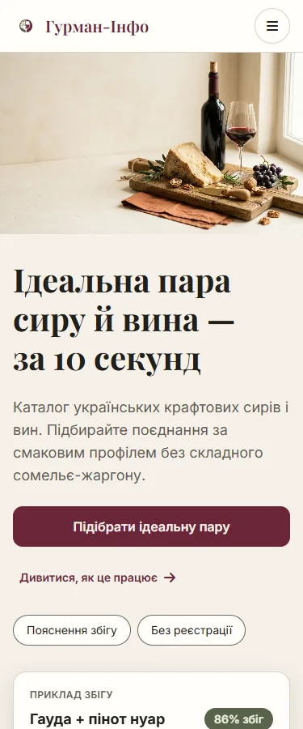

# Гурман-Інфо

Адаптивний лендинг сервісу **«Гурман-Інфо»**: підбір гастрономічних пар «сир + вино» з відсотком збігу та поясненням, чому пара працює. Каталог українських крафтових сирів і вин, пошук у два боки («Сир → Вино» і «Вино → Сир»), підписка на розсилку.

**Живі версії**

- GitHub Pages: <https://oper100.github.io/gurman-info-landing/>
- Netlify: <https://gurman-info-landing.netlify.app/>
- Vercel: <https://gurman-info-landing.vercel.app/>




## Технології

- HTML5 із семантичною розміткою (`header`, `nav`, `main`, `section`, `aside`, `footer`)
- Tailwind CSS 3.4 (режим Play CDN) і власні токени дизайн-системи в `css/custom-styles.css`
- Нативний JavaScript без бібліотек: меню, підбір пари, перевірка форми, керування відео
- Вбудовування: відео YouTube (`iframe`), Google Maps, віджет погоди Meteoblue
- Шрифти Playfair Display та Inter (Google Fonts), піктограми Font Awesome

## Форма зворотного зв'язку

Секція «Напишіть нам» (`#feedback`): семантична адаптивна форма з клієнтською валідацією на Vanilla JavaScript (`js/validation.js`) і модальним вікном після успішної перевірки.

| Поле | Тип | Правило | Приклад |
|---|---|---|---|
| Ім'я | `text` | ≥ 2 символи; літери, пробіл, апостроф, дефіс | Ірина |
| Електронна пошта | `email` | RegEx `^[a-zA-Z0-9._%+-]+@[a-zA-Z0-9.-]+\.[a-zA-Z]{2,}$` | user@gmail.com |
| Телефон | `tel` | RegEx `^\+380\d{9}$` (формат `+380XXXXXXXXX`) | +380501234567 |
| Повідомлення | `textarea` | ≥ 10 символів | … |
| Згода | `checkbox` | обов'язково | ✓ |

- Помилка з'являється після взаємодії з полем (input → blur → submit), а не одразу після відкриття сторінки.
- Номер телефону: `0501234567` автоматично перетворюється на `+380501234567`, зайві символи прибираються.
- Стани поля: normal, focus, error, success; `aria-invalid`, `aria-describedby`, фокус переходить на перше поле з помилкою.
- Дані нікуди не надсилаються: після успішної перевірки показується модальне вікно (демонстрація), форма очищається.

## Запуск локально

Збирати нічого не потрібно: сторінка статична.

```bash
git clone https://github.com/oper100/gurman-info-landing.git
cd gurman-info-landing
# варіант 1: відкрити index.html у браузері
# варіант 2: локальний сервер
python -m http.server 8000
```

Після цього відкрийте <http://localhost:8000/>.

## Структура проєкту

```text
index.html          головна сторінка
privacy.html        політика конфіденційності
css/                токени дизайн-системи, фокус, <progress>
js/                 тема Tailwind, меню, підбір і форми, відео, валідація форми зворотного зв'язку
assets/             зображення (WebP), піктограми, логотип
docs/screenshots/   знімки для README
```

## Публікація

Сайт розгорнуто двома способами: **GitHub Pages** (гілка `main`, корінь репозиторію; оновлюється після кожного `git push`) **Netlify** і **Vercel** (статичний хостинг без етапу збирання: *Build command* порожня, *Publish directory* / *Root Directory* — корінь; Vercel: *Framework Preset* — Other). Усі три платформи самі публікують нову версію після кожного `git push` у `main`.

## Автор

Федунів Б. М., група ПП-24, НУ «Львівська політехніка». Проєкт створено в межах курсу «Технології веб-розробки та дизайну» (лабораторні роботи №7 і №8).
